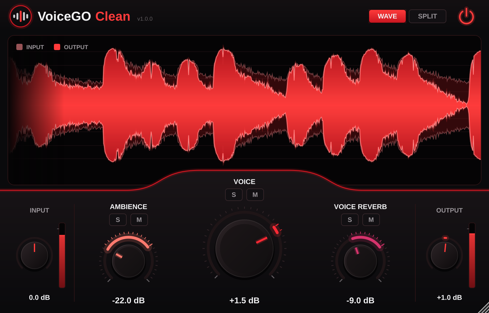
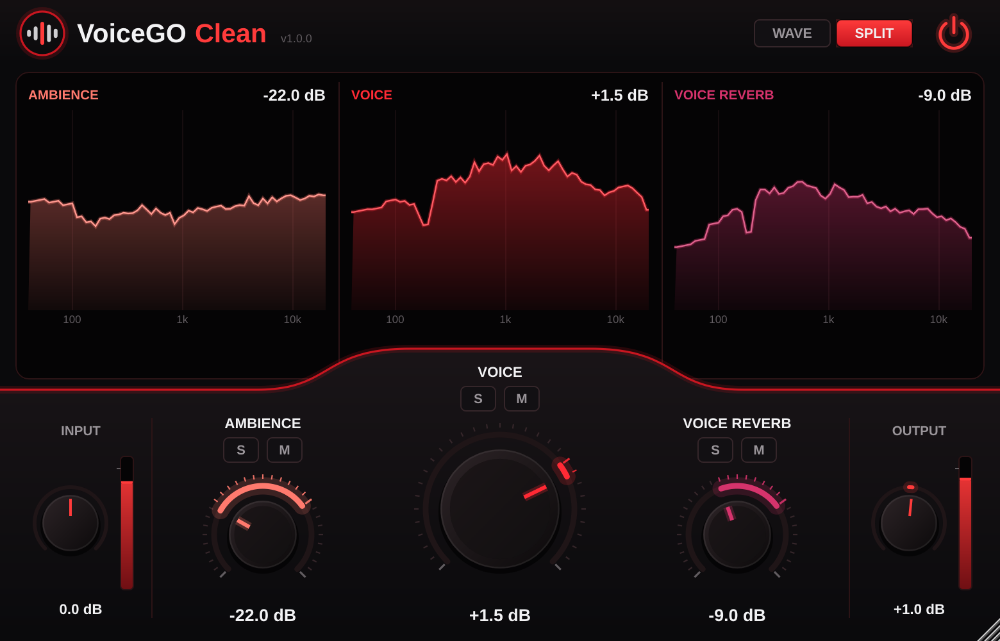

# VoiceGO Clean

Plugin de áudio (VST3 / AU / app) que separa uma gravação de voz em três partes,
cada uma com seu próprio controle:

| Controle | O que é |
|---|---|
| **AMBIENCE** | ruído de fundo constante: chiado, zumbido, ar-condicionado, som da sala |
| **VOICE** | a voz direta (seca) |
| **VOICE REVERB** | a reverberação da sala sobre a voz |

Cada knob vai de **OFF** (remove) a **+12 dB**, com **0 dB** = original. Também há **S** (solo) e **M** (mute)
por componente, **Input/Output** com medidores, **bypass** (power) e duas visualizações:
**WAVE** (entrada x saída) e **SPLIT** (espectro de cada componente).




## Instalar (macOS)

Baixe `VoiceGO-Clean-<versão>-macOS-Universal.pkg` (em *Releases* ou em *Actions › Artifacts*) e dê dois cliques.
Um instalador só para **Apple Silicon e Intel**. Ele coloca:

- `/Library/Audio/Plug-Ins/VST3/VoiceGO Clean.vst3`
- `/Library/Audio/Plug-Ins/Components/VoiceGO Clean.component` (AU)
- `/Applications/VoiceGO Clean.app`
- desinstalador em `/Library/Application Support/VoiceGO Clean`

Primeira vez (instalador sem assinatura da Apple): se aparecer "desenvolvedor não identificado",
vá em *Ajustes do Sistema › Privacidade e Segurança › Abrir Mesmo Assim*.

## Como funciona

Processamento no domínio STFT (FFT de 2048 a 44,1/48 kHz, 75% de sobreposição):

- **Ambience**: ruído estacionário estimado por *minimum statistics* (janela de 1,5 s).
- **Voice reverb**: reverberação tardia por modelo estatístico de decaimento da sala (RT60 0,6 s),
  alimentado só pela energia já limpa de ruído.
- **Voice**: máscara de Wiener com SNR *decision-directed* contra (ruído + reverb).
- As três máscaras somam sempre 1: com tudo em 0 dB a saída é idêntica à entrada (resíduo de −138 dB nos testes).
- Latência: 2048 amostras (~43 ms), informada à DAW (compensação automática).

## Compilar

O workflow `.github/workflows/build.yml` faz tudo a cada push: compila num Mac da nuvem em **Universal
(arm64 + x86_64)**, roda os testes, monta o `.pkg`, instala de verdade e valida o AU com o `auval` da Apple.
Para publicar uma Release: crie uma tag `v1.0.0`.

Assinatura/notarização (opcional): configure os secrets `MACOS_CERT_P12_BASE64`, `MACOS_CERT_PASSWORD`,
`APPLE_ID`, `APPLE_TEAM_ID` e `APPLE_APP_PASSWORD`. Sem eles, os bundles saem com assinatura ad-hoc.

Testes do motor (qualquer sistema):

```bash
cmake -S . -B build -DVOICEGO_BUILD_TESTS=ON && cmake --build build --target VoiceGOCleanTest
./build/VoiceGOCleanTest_artefacts/Release/VoiceGOCleanTest selftest
```

## Formatos

VST3 e AU (macOS), VST3 (Windows/Linux) e app standalone. **VST2 não é possível**: a Steinberg deixou de
licenciar o SDK do VST2 em 2018 e ele não pode ser distribuído. Hoje todas as DAWs leem VST3.
